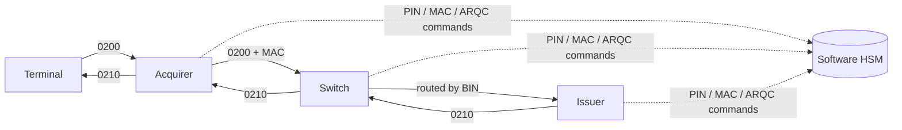

# MiniSwitch

[](https://github.com/tarikiguezarane/miniswitch/actions/workflows/ci.yml)
[](LICENSE)

**Card authorisation chain simulation in ISO 8583**: terminal → acquirer → switch → issuer,
with every cryptographic operation (PIN blocks ISO 9564 formats 0 and 4, MAC, EMV ARQC/ARPC)
delegated to a software HSM, as in a real payment system.

> Status: work in progress, built step by step following [ROADMAP.md](ROADMAP.md)
> (progress log in [JOURNAL.md](JOURNAL.md), both in French).
> **Test cards, keys and data only.** Every algorithm is validated against test vectors.

## Flow



Sequence diagram, module roles and key hierarchy in [docs/flow.md](docs/flow.md).

## Modules

```
iso8583/   ISO 8583 messages, bitmaps, packagers, TCP framing
hsm/       Software HSM: key hierarchy, PIN, MAC, EMV cryptography
terminal/  Terminal simulator
acquirer/  Acquirer host
switch/    Payment switch (Java package `switching`, `switch` being a keyword)
issuer/    Issuer host
docs/      Flow and cryptography notes
```

## Build

Requires Java 21 and Maven 3.9+.

```bash
mvn verify
```

The build compiles with `-Xlint:all -Werror` and runs the unit tests of every module.

## Stack

Java 21 · Maven multi-module · Netty · BouncyCastle · PostgreSQL / H2 · JUnit 5 ·
Docker Compose · OpenTelemetry · GitHub Actions

## License

[MIT](LICENSE) © 2026 Tarik Iguezarane
