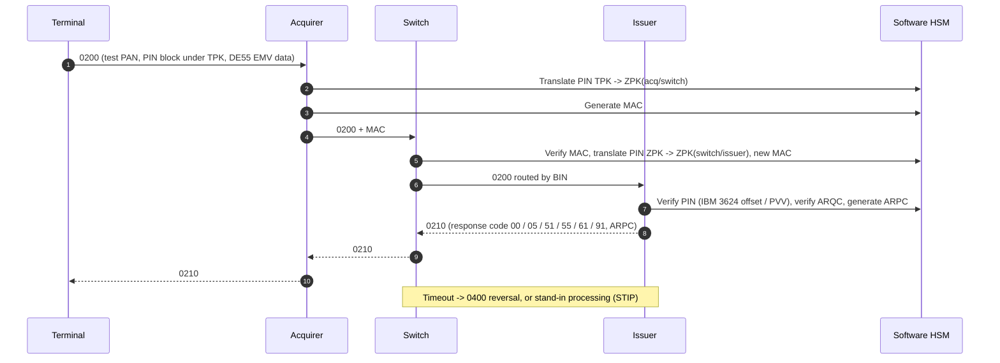

# Authorisation flow



## Modules

| Module | Role |
|--------|------|
| `iso8583` | MTI, primary and secondary bitmaps, field definitions (fixed, LLVAR, LLLVAR), packagers, 2-byte length TCP framing |
| `hsm` | Key hierarchy (local master key, ZMK, ZPK, TPK, PVK, EMV master key), KCV, PIN blocks ISO 9564 formats 0 and 4, MAC ISO 9797-1 alg. 3 and AES-CMAC, EMV ARQC/ARPC |
| `terminal` | Sends 0200 requests with encrypted PIN and EMV data |
| `acquirer` | PIN translation, MAC, routing to the switch |
| `switch` | BIN routing table, MAC check and regeneration, timeouts and 0400 reversals, STIP |
| `issuer` | Accounts and cards, limits, balance, card status, PIN and ARQC verification |

## Key hierarchy (target)

```
Local master key (LMK, simulated)
├── ZMK  zone master key, shared between two parties, protects key exchange
│   └── ZPK  zone PIN key, protects PIN blocks between hosts
├── TPK  terminal PIN key, protects PIN blocks from the terminal
├── PVK  PIN verification key (issuer)
└── EMV issuer master key -> card master key -> session key (ARQC / ARPC)
```

All keys, cards and PANs used in this repository are **test values only**.
